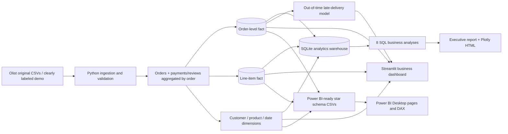

# Architecture — CommercePulse

## Modeling grain

- `fact_orders`: **one row per order**, no row multiplication from multi-payment/multi-review orders; uses persistent `customer_unique_id` for repeat analysis.
- `fact_items`: **one row per order line**; category, seller, price, freight, and item GMV.
- `dim_customers`: **one row per persistent unique customer**; full-history RFM using snapshot date after last purchase.
- `dim_products`: **one row per unique product**.
- `dim_date`: **one row per calendar day**.

## Metric contract

**Delivered merchandise GMV** = SUM(price of line items on orders marked delivered), **excluding freight, undelivered/cancelled orders, refunds and taxes**. It is NOT accounting revenue or profit.

**AOV** = Delivered merchandise GMV / delivered order count.

**Late delivery %** = Delivered orders with `delivered_at > estimated_delivery_at` / delivered orders.

**Repeat buyer share (all-time)** = unique customer IDs with 2+ historical delivered orders / all customers observed in the order data.

**Risk prediction** = binary classification evaluated on most recent 20% of delivered orders by purchase date. Realized `review_score`, `delivered_at`, `delivery_days`, `delay_days` are EXCLUDED from input features to reduce target leakage.

## Limitations

No current financials, acquisition spend, profit, returns/refunds, or production shipping feeds. Past data cannot provide actual 2026 market insights. `risk_tier` applies only to the holdout predictions; operational risk requires live inputs, monitoring and calibration.
